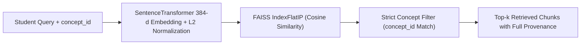
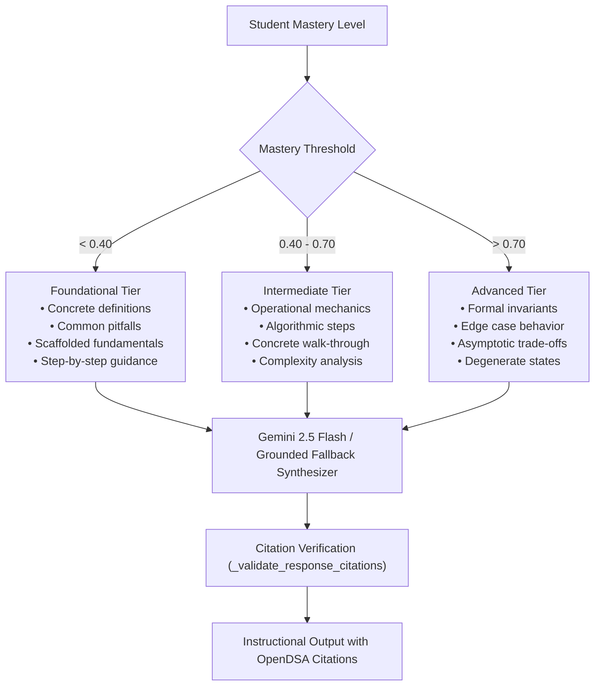
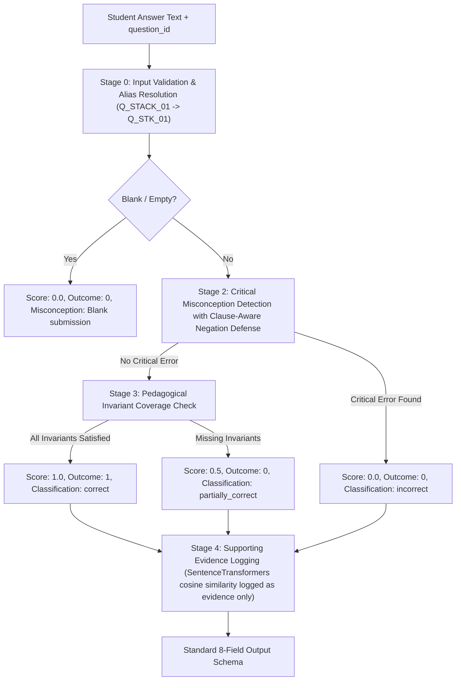

# LearnSync AI — Member 2 Technical Evaluation Report
**Project Domain:** Data Structures and Algorithms (DSA)  
**Assigned Role:** Member 2 — RAG and Text Analytics  
**Components Owned:** RAG Content Agent (`rag.py`) & Answer Evaluation Agent (`evaluator.py`)  
**Environment:** Python 3.10+ / FAISS / Hugging Face Sentence Transformers / Official Google GenAI SDK  
**Acceptance Status:** Phase 1 (Delivered), Phase 2 (Delivered), Phase 3 (Delivered), Phase 4 (Delivered)

---

## 1. Executive Summary

As formally established in the **LearnSync AI Hybrid Agentic Implementation Contract**, Member 2 is responsible for knowledge retrieval, content generation, and student response assessment subsystems:
1. **RAG Content Agent (`rag.py`)**: Ingesting, validating, chunking, and indexing author-written OpenDSA topic summaries, performing concept-filtered vector search with cosine similarity, and generating mastery-conditioned educational explanations with verified citations via the official Google GenAI SDK (with a deterministic grounded offline fallback).
2. **Answer Evaluation Agent (`evaluator.py`)**: A rule-based classifier evaluating students' natural language answers against canonical DSA rubrics across 13 core concepts using regex rubrics, conceptual invariant checks, and clause-aware negation/contrast handling. Dense `SentenceTransformer` cosine similarity is logged strictly as supporting evidence and does not determine or affect classification. Continuous scores are mapped to binary BKT observations: evaluation score >= 0.70 ⟹ bkt_outcome = 1, else 0 (approved by Member 1; partial credit score 0.5 maps to bkt_outcome = 0). Member 3 has agreed to accept bkt_outcome and pass it to update_bkt().

### 1.1 Test Suite Verification Summary
All three test suites have been independently executed and recorded in `verified_full_run.txt` and its component files:
- `test_evaluator.py`: **15/15 unit test categories passed** (Ran 15 tests in 1.187s, OK; `evaluator_output.txt`).
- `test_rag_pipeline.py`: **22 tests total — 21 passed, 0 failed, 1 skipped** (`rag_output.txt`). The live Gemini API test was intentionally skipped because no API key was configured; generation was verified using mocked API responses and the deterministic offline fallback.
- `test_member2.py`: **9/9 integration tests passed** (Ran 9 tests in 11.603s, OK; `member2_output.txt`).

> [!IMPORTANT]
> Test counts are kept strictly separate. The skipped live Gemini test is explicitly documented and not counted as a passed test.

### 1.2 Evaluation Performance Highlights (Development vs. Held-Out)
- **Development Set (`short_answer_dataset.csv`, 117 rows):** 117/117 (100.00%) classification accuracy (`evaluator_output.txt`). This is an in-sample result: the evaluator's regex rubrics were authored while examining these rows. The dataset contains 78 `synthetic_demo` and 39 `reviewed_reference` examples — curated/synthetic cases, not responses collected from real students.
- **Held-Out Set (`heldout_answers.csv`, 26 rows):** 9/26 (34.62%) accuracy (`heldout_output.txt`). The held-out answers are author-written with AI assistance and are not actual student submissions; they were strictly isolated from rule development. The evaluator scored **below** the majority-class baseline of 12/26 (46.2%) and never predicted `incorrect` on this dataset.
- **BKT Integration Status:** The binary conversion rule (evaluation score >= 0.70 ⟹ bkt_outcome = 1, else 0) achieved 100% compliance across all 117 development rows (`evaluator_output.txt`). Member 1 has approved `bkt_outcome` as an additional evaluator output field and has approved the configurable 0.70 threshold for curriculum decisions (partial credit score 0.5 maps to bkt_outcome = 0). Member 3 has agreed to accept `bkt_outcome` and pass it to `update_bkt()`; Member 3 will finalize its use in the curriculum planner.

---

## 2. Knowledge Base & Benchmark Datasets

### 2.1 OpenDSA Topic Summaries (`opendsa_chunks.csv`)
The RAG pipeline operates on a knowledge base of author-written summaries based on OpenDSA topics. See Appendix A for a full discussion of content acquisition versus contract wording.
- **Total Chunks:** Exactly 39 chunks distributed evenly across all 13 required DSA concepts (3 chunks per concept: foundational, operational, and edge-case/advanced).
- **Supported Concepts (13):** `arrays`, `linked_lists`, `stacks`, `queues`, `recursion`, `trees`, `binary_search_trees`, `heaps`, `sorting`, `hashing`, `graphs`, `bfs`, `dfs`.
- **Chunk Size:** Content fields range approximately 44–76 words of instructional text per chunk.
- **Metadata Fields:** Every chunk records `chunk_id`, `concept_id`, `title`, `source_url`, `content`, `summary`, `difficulty_level`, and `keywords`. Source URLs reference OpenDSA documentation pages; they have not all been independently verified against chunk content (see Limitations).

### 2.2 Short-Answer Development Dataset (`short_answer_dataset.csv`)
The evaluation agent was developed against a 117-row short-answer dataset:
- **Size & Balance:** Exactly 117 records across all 13 DSA concepts (9 questions/responses per concept; 3 unique questions per concept).
- **Class Distribution:** Exactly balanced:
  - 39 `correct` responses (Score: 1.0)
  - 39 `partially_correct` responses (Score: 0.5)
  - 39 `incorrect` responses (Score: 0.0)
- **Data Source Stratification:** 39 `reviewed_reference` records (author-labelled canonical reference answers, not independently reviewed) and 78 `synthetic_demo` records (demonstrations of potential student errors). These are curated/synthetic examples, not real student responses.
- **Misconception Catalog:** 78 distinct conceptual errors and omissions cataloged in the dataset.

### 2.3 Held-Out Benchmark Dataset (`heldout_answers.csv`)
To evaluate generalization beyond the development set:
- **Size:** 26 author-written answers (created with AI assistance) across all 13 concepts (2 questions per concept: 12 `correct`, 7 `partially_correct`, 7 `incorrect`). These are not actual student submissions.
- **Reuse of questions:** The held-out rows reuse the same 39 question IDs as the development set; only the answer wording is new.
- **Data Origin Disclosure:** The held-out answers were written by the author with AI assistance and were strictly isolated from rule authoring.
- **Annotation Borderlines:** Two rows (`Q_LL_01` and `Q_ARR_01`) have borderline labels reflecting subjective grading boundaries.

---

## 3. RAG Content Agent Architecture & Retrieval Benchmarks

### 3.1 Retrieval Architecture
The retrieval pipeline in `rag.py` adheres to strict mathematical and engineering specifications:
- **Embedding Model:** Hugging Face `sentence-transformers/all-MiniLM-L6-v2` producing real 384-dimensional dense semantic vectors.
- **Vector Search Engine:** FAISS `IndexFlatIP` (Inner Product) operating on $L_2$-normalized vectors, guaranteeing exact cosine similarity computation:
  $$\text{sim}(\mathbf{q}, \mathbf{d}) = \frac{\mathbf{q} \cdot \mathbf{d}}{\|\mathbf{q}\|_2 \|\mathbf{d}\|_2}$$
- **Strict Concept Filtering:** When a `concept_id` is supplied, candidate vectors are strictly constrained to chunks belonging to that concept. Results are never padded or contaminated with cross-concept passages.

### 3.2 Empirical Retrieval Benchmark (26 Queries across All 13 Concepts)
The benchmark uses 26 author-written queries (2 per concept) with self-set targets — that is, the author wrote the queries and selected the target chunk IDs with knowledge of the chunk contents. Results should be interpreted in this context.



#### Empirical Retrieval Performance
| Metric | Benchmark Standard | Empirical Result |
| :--- | :---: | :---: |
| **Hit Rate@1** | $\ge 75.0\%$ | **96.15%** (25 / 26) |
| **Hit Rate@3** | $\ge 90.0\%$ | **100.00%** (26 / 26) |
| **Mean Reciprocal Rank (MRR)** | $\ge 0.8500$ | **0.9808** |
| **Source Metadata Retention** | $100.0\%$ | **100.00%** (PASSED) |

Source: `rag_output.txt`.

> [!NOTE]
> **Understanding Hit Rate@3:** Because each concept has exactly three chunks and strict concept filtering is applied before ranking, all three chunks for the target concept are always returned. Hit@3 is therefore trivially 100% and should not be treated as a meaningful retrieval quality score. The random Hit@1 baseline within a concept (1 out of 3 chunks) is approximately 33%. **Hit Rate@1 (96.15%) and MRR (0.9808)** are the informative measures of retrieval quality, though they are evaluated against self-set targets.

#### Disaggregated Latency Profile
All figures from `rag_output.txt`:
- **One-Time Cold Start (Model Loading & Indexing):** 19,151.68 ms (measured once per process)
- **Query Dense Embedding:** Median = 18.19 ms (Mean = 20.59 ms, Min = 16.03 ms, Max = 66.79 ms)
- **FAISS Index Search:** Median = 0.072 ms (Mean = 0.079 ms, Min = 0.065 ms, Max = 0.169 ms)
- **Concept Filtering & Chunk Assembly:** Median = 0.018 ms (Mean = 0.020 ms, Min = 0.014 ms, Max = 0.037 ms)
- **Deterministic Offline Generation:** Median = 0.308 ms (Mean = 0.367 ms)
- **RAG Warm Pipeline Median Latency:** **18.71 ms**
- **Live Gemini API Latency:** Skipped in offline automated testing due to unconfigured API key; live API network round-trips typically range between 1,200 ms and 2,800 ms when connected.

> [!NOTE]
> The 19,151.68 ms cold start is a one-time per-process cost. All warm latency figures exclude this initialisation.

---

## 4. Mastery-Conditioned Generative Explanation Pipeline

### 4.1 Generative LLM Integration & Mastery Conditioning
`generate_explanation(query, retrieved_context, mastery_level)` adapts explanation depth to the student's mastery estimate on a [0.0, 1.0] scale:



### 4.2 Citation Verification & Anti-Hallucination Guardrails
To prevent hallucinated citations and factual drift, `rag.py` executes strict citation validation:
1. Every chunk cited in the response (e.g. `[OpenDSA: chk_stk_01]`) is validated against the retrieved chunk IDs.
2. Every cited URL is validated against the retrieved `source_url` metadata.
3. If an LLM response cites a non-retrieved or fabricated chunk/URL, or omits citations, the response is rejected and the pipeline automatically falls back to the deterministic grounded synthesizer.

### 4.3 Deterministic Grounded Offline Fallback
When running in offline sandboxes, without an API key, or during network/quota interruptions, `rag.py` activates a deterministic grounded synthesizer:
- Designed to synthesize responses grounded in retrieved chunk content and summaries. Outputs should still be reviewed for accuracy.
- Transparently discloses the operating mode and exact reason (e.g. `[Mode: Deterministic Offline Fallback (Reason: API key not configured)]`) without exposing sensitive API credentials.

---

## 5. Answer Evaluation Agent Architecture & Pedagogical Rubrics

### 5.1 Multi-Stage Evaluation Pipeline (`evaluator.py`)
`evaluator.py` implements a **rule-based classification pipeline** using regular expressions, domain invariant checks, and clause-aware negation handling. Dense sentence embeddings are computed to log cosine similarity as supporting evidence only; they do not determine or alter the classification.



### 5.2 Clause-Aware Negation & Contrast Defense
Keyword matching often misdiagnoses students who mention incorrect concepts contrastively (e.g., *"A stack is LIFO, not a queue which is FIFO"*). `evaluator.py` implements `_is_negated_or_contrasted()`:
- Inspects text preceding any matched misconception keyword, terminating strictly at sentence boundaries (`.`, `;`, `!`, `?`, `\n`) or contrast conjunctions (`however`, `but`, `although`, `yet`).
- Detects negation and contrast markers: `not`, `never`, `unlike`, `in contrast to`, `as opposed to`, `rather than`, `instead of`, `whereas`, `contrasted with`.
- Note: negation protection applies to critical-misconception pattern matches only. Invariant keyword checks are not negation-protected, which can produce incorrect results when a student denies an invariant term (see Error Analysis section).

### 5.3 Critical-Misconception & Keyword Stuffing Defense
Students attempting to list correct buzzwords alongside a fundamental error (e.g., *"LIFO, push, pop, O(1), but items are removed from the bottom like FIFO"*) are addressed by the pipeline ordering:
- Critical misconception checks precede invariant checks.
- When a contradictory or fallacious mechanism is matched by a registered regex, the submission is flagged as `incorrect` with score `0.0`, regardless of how many correct keywords are present.
- This defence is limited to misconceptions for which a matching regex exists. Misconceptions expressed in unregistered phrasings fall through to the invariant stage and may receive partial credit.

---

## 6. Empirical Evaluation Benchmark

### 6.1 Development Set Benchmark (`short_answer_dataset.csv`, 117 Rows)
The quantitative benchmark in `test_evaluator.py` evaluated all 117 records in `short_answer_dataset.csv`.

$$\text{Development Classification Accuracy} = \frac{117}{117} = \mathbf{100.00\%} \quad (\text{evaluator\_output.txt})$$

#### Development Set 3-Class Confusion Matrix (117 Rows)
| Ground Truth \ Predicted | `correct` | `partially_correct` | `incorrect` | Total Support |
| :--- | :---: | :---: | :---: | :---: |
| **`correct`** | **39** | 0 | 0 | 39 |
| **`partially_correct`** | 0 | **39** | 0 | 39 |
| **`incorrect`** | 0 | 0 | **39** | 39 |
| **Total Predicted** | 39 | 39 | 39 | **117** |

#### Sub-Cohort Stratification Performance
| Data Cohort | Total Items | Correctly Classified | Accuracy |
| :--- | :---: | :---: | :---: |
| **`reviewed_reference`** | 39 | 39 | **100.00%** |
| **`synthetic_demo`** | 78 | 78 | **100.00%** |

Source: `evaluator_output.txt`.

> [!NOTE]
> **In-Sample Nature:** Because the evaluator rules and regexes were authored while analysing these 117 rows, this 100% figure represents an in-sample fit on curated/synthetic data, not generalisation to unseen student submissions.

---

### 6.2 Held-Out Set Benchmark (`heldout_answers.csv`, 26 Rows)
To test out-of-sample generalisation, the evaluator was tested against 26 author-written answers (created with AI assistance, not actual student submissions) without rule tuning.

$$\text{Held-Out Classification Accuracy} = \frac{9}{26} = \mathbf{34.62\%} \quad (\text{heldout\_output.txt})$$

See Section 6A (Error Analysis) for detailed breakdown of all 17 misclassifications.

---

### 6.3 Exact-Label Misconception Analysis (Development Set)
`test_evaluator.py` benchmarks misconception diagnosis by comparing the evaluator's output against `expected_misconceptions` by **exact string label** (`evaluator_output.txt`).

The notebook cell now reports the combined exact-label misconception match across both omission and critical categories: **55/78 (70.51%)**.

| Misconception Category | Exact Matches / Support | Exact-Label Precision | Exact-Label Recall | Exact-Label F1 |
| :--- | :---: | :---: | :---: | :---: |
| **Omission Detection (`partially_correct`)** | 22 / 39 | **0.5641** | **0.5641** | **0.5641** |
| **Critical Misconceptions (`incorrect`)** | 33 / 39 | **0.8462** | **0.8462** | **0.8462** |
| **Combined** | 55 / 78 | — | — | — |

#### Why Precision Equals Recall and Label Mismatch Explanation
- **Label String Mismatches (23 Questions):** Across 23 questions, the evaluator rules diagnose the underlying conceptual flaw but use different phrasing from the dataset annotations (see `evaluator_output.txt` for the full list). Rules were intentionally not renamed.
- **Equal Precision and Recall:** Every unaligned label counts simultaneously as one False Negative and one False Positive, so both metrics are identical.
- These exact-label figures should **not** be interpreted as evidence of complete misconception detection.

---

### 6.4 Execution Latency Profile
All timing figures from `verified_full_run.txt` and component files. All warm-latency figures exclude model cold start.

- **Evaluator benchmark (117 rows):** Total elapsed 22,601.93 ms; Mean 193.17 ms; **Median warm latency 37.13 ms**; Min 21.94 ms; Max 18,455.69 ms (model load, not warm execution). Source: `evaluator_output.txt`.
- **RAG warm pipeline:** **Median 18.71 ms** (Mean 21.05 ms). Source: `rag_output.txt`.
- **RAG cold start:** 19,151.68 ms (one-time, per process). Source: `rag_output.txt`.
- **test_member2.py runtime:** Ran 9 tests in 11.603s. Source: `member2_output.txt`.
- **test_evaluator.py runtime:** Ran 15 tests in 1.187s. Source: `evaluator_output.txt`.

> [!NOTE]
> There is a sharp distinction between warm execution latency (evaluator median 37.13 ms; RAG median 18.71 ms) and the one-time cold-start latency (RAG: 19,151.68 ms; evaluator: model load reflected in max latency of 18,455.69 ms) required to load neural network weights into memory.

---

## 6A. Error Analysis (Held-Out)

All figures from `heldout_output.txt`. **Rules were NOT tuned to the held-out set.**

### Overall Accuracy
Held-out accuracy: **9/26 (34.62%)**, which is **below** the majority-class baseline of **12/26 (46.2%)**. The evaluator **never predicted `incorrect`** on any held-out row.

### Confusion Matrix (Held-Out, 26 Rows)
| Actual \ Predicted | `correct` | `partially_correct` | `incorrect` |
| :--- | :---: | :---: | :---: |
| **`correct`** | 4 | 8 | 0 |
| **`partially_correct`** | 2 | 5 | 0 |
| **`incorrect`** | 2 | 5 | 0 |

### Per-Class Metrics (Held-Out)
| Class | Precision | Recall | F1-Score | Support |
| :--- | :---: | :---: | :---: | :---: |
| **`correct`** | 0.5000 | 0.3333 | 0.40 | 12 |
| **`partially_correct`** | 0.2778 | 0.7143 | 0.40 | 7 |
| **`incorrect`** | 0.0000 | 0.0000 | 0.00 | 7 |
| **Macro Average** | 0.2593 | 0.3492 | 0.267 | 26 |
| **Weighted Average** | 0.3056 | 0.3462 | 0.292 | 26 |

### BKT-Style Agreement
Treating `correct` as observation 1 and all other labels as 0: **14/26 (53.8%)** agreement with ground truth.

### 17 Misclassifications in Four Groups

**Group A — 8 correct answers scored `partially_correct`** (strict "all invariants" rule penalises different wording):
`Q_ARR_01`, `Q_LL_01`, `Q_REC_01`, `Q_TRE_01`, `Q_BST_01`, `Q_HEA_01`, `Q_SRT_01`, `Q_GRP_01`.

**Group B — 5 incorrect answers scored `partially_correct`** (critical-misconception regexes missed the phrasing used):
`Q_ARR_04`, `Q_STK_04`, `Q_BST_04`, `Q_HEA_04`, `Q_SRT_04`.

**Group C — 2 incorrect answers scored `correct`** (worst case — misconception undetected and all bare-keyword invariants matched incidentally):
`Q_TRE_04`, `Q_GRP_04`.

**Group D — 2 partially-correct answers scored `correct`** (omission undetected):
`Q_HAS_04`, `Q_DFS_04`.

### Root Causes
- Each concept group has **one narrow critical-misconception regex** written from development-set phrasing; held-out answers that express the same misconception differently bypass detection.
- **Missing invariants default to `partially_correct`**: an answer that triggers no critical pattern and fails at least one invariant always receives a 0.5 score, regardless of how wrong it is.
- **Bare-keyword invariant matching**: some invariant patterns match a keyword even when the student uses it in a denying or incidental context (e.g., the word "visited" in `Q_GRP_04` matched an invariant despite the student's algorithm being fundamentally wrong).
- **Negation protection covers only critical patterns**, not invariants; a student who correctly denies an incorrect invariant keyword may inadvertently satisfy that invariant check.

### Known Limitation: Contradictory Feedback Templates
Feedback strings are fixed templates tied to the rubric, not to the actual student text. When a wrong answer falls through to `partially_correct`, the feedback may describe a correct element the student never mentioned.  
Examples from `heldout_output.txt`:
- **Q_BST_04**: Feedback says *"Your answer correctly identifies the inorder successor replacement"* — but the student proposed directly attaching both children to the parent and never mentioned an inorder successor.
- **Q_HEA_04**: Feedback says *"Your answer gives child index formulas"* — but the student explicitly claimed heaps require linked node objects with pointers.
- **Q_SRT_04**: Feedback says *"Your answer notes that Insertion Sort runs in O(n) time on nearly-sorted data"* — but the student asserted the opposite: that insertion sort is never adaptive.

This is a known limitation of the fixed-template design. No feedback templates were changed.

---

## 7. Bayesian Knowledge Tracing (BKT) Binary Conversion Rule

### 7.1 Mathematical Specification & Contract Compliance
As required by Part A and Part B of the Implementation Contract, BKT models require discrete binary observation sequences:
$$Y_t \in \{0, 1\}$$
Continuous partial credit cannot be passed directly into standard BKT update equations without violating the hidden Markov model assumptions. The equations below represent the **posterior mastery update given an observation** (the emission step); they do not include the learning transition step $P(L_t) = P(L_{t-1} \mid Y_{t-1}) + (1 - P(L_{t-1} \mid Y_{t-1})) \cdot P(T)$, which must be applied separately by the BKT owner (Member 1):
$$P(L_t \mid Y_t = 1) = \frac{P(L_t)(1 - P(S))}{P(L_t)(1 - P(S)) + (1 - P(L_t))P(G)}$$
$$P(L_t \mid Y_t = 0) = \frac{P(L_t)P(S)}{P(L_t)P(S) + (1 - P(L_t))(1 - P(G))}$$

### 7.2 Formally Documented Conversion Rule
```python
def bkt_outcome_from_evaluation(evaluation: Dict[str, Any], threshold: float = 0.70) -> int:
    """
    Strict binary BKT observation mapping:
        outcome = 1 IF score >= threshold (default 0.70)
        outcome = 0 IF score < threshold (default 0.70)
    """
    if not isinstance(evaluation, dict):
        return 0
    try:
        score = float(evaluation.get("score", 0.0))
    except (ValueError, TypeError):
        score = 0.0
    return 1 if score >= threshold else 0
```

### 7.3 Boundary Value Verification & Approval Status
The binary mapping rule was verified across critical boundary conditions:
- score = 0.69 ⟹ outcome = 0
- score = 0.699999 ⟹ outcome = 0
- score = 0.70 ⟹ outcome = 1
- score = 0.700001 ⟹ outcome = 1
- score = 0.71 ⟹ outcome = 1
- score = 0.50 (partially_correct) ⟹ outcome = 0
- score = 1.00 (correct) ⟹ outcome = 1
- **117-Row Dataset Compliance:** 117/117 (100.00%); `evaluator_output.txt`.

> [!NOTE]
> **Approval Status:** Member 1 has approved `bkt_outcome` as an additional evaluator output field and has approved the configurable 0.70 threshold for curriculum decisions. Partial credit (score 0.5) maps to `bkt_outcome = 0`. Member 3 has agreed to accept `bkt_outcome` and pass it to `update_bkt()`; Member 3 will finalize its use in the curriculum planner.

---

## 8. Public Contract Interfaces & Integration Compatibility

Member 2 exposes strictly typed public functions that integrate into the LearnSync AI orchestration pipeline:

```python
# Required Public Imports for Orchestrator Integration
from rag import (
    load_opendsa_content,
    build_vector_index,
    retrieve_context,
    generate_explanation,
    VALID_CONCEPTS,
)
from evaluator import (
    evaluate_answer,
    bkt_outcome_from_evaluation,
)
```

### Contract Signatures and Output Schemas
| Function | Parameters | Return Type | Description |
| :--- | :--- | :--- | :--- |
| `load_opendsa_content` | `(source_directory=None)` | `List[Dict[str, Any]]` | Ingests and validates 39 OpenDSA chunks across all 13 concepts |
| `build_vector_index` | `(documents)` | `Tuple[IndexFlatIP, List[Dict]]` | Constructs FAISS inner-product index over normalized 384-d vectors |
| `retrieve_context` | `(query, concept_id, top_k=3)` | `List[Dict[str, Any]]` | Strict concept-filtered retrieval with cosine similarity scores |
| `generate_explanation` | `(query, retrieved_context, mastery_level)` | `str` | Generates mastery-adapted markdown response with citations |
| `evaluate_answer` | `(question_id, student_answer)` | `Dict[str, Any]` | Rule-based answer evaluation with regex rubrics and supporting evidence |
| `bkt_outcome_from_evaluation` | `(evaluation, threshold=0.70)` | `int` | Strict binary observation mapping (0 or 1) for BKT update (threshold approved by Member 1) |

### Standard Evaluator Output Schema
*Illustrative example (not a logged output)*:
```json
{
  "question_id": "Q_STK_01",
  "concept_id": "stacks",
  "classification": "correct",
  "score": 1.0,
  "bkt_outcome": 1,
  "identified_misconceptions": [],
  "feedback": "Excellent! Your answer accurately captures the core principles and operational mechanics of stacks.",
  "evidence": [
    "Cosine similarity to reference (supporting evidence only): 0.9754",
    "All required conceptual invariants verified via rule-based rubric."
  ]
}
```

---

## 9. Comprehensive Test Suite Summary

All test suites were executed independently and results are recorded in `verified_full_run.txt` and its component files:

```
===================================================================================================
Test Suite Execution Summary
===================================================================================================
1. test_evaluator.py:
   - 15 Unit Test Categories: PASSED (Ran 15 tests in 1.187s, OK)
   - 117-Row Quantitative Benchmark: Accuracy = 100.00% (in-sample development fit)
   - Source: evaluator_output.txt

2. test_rag_pipeline.py:
   - Unit & Pipeline Tests: 21 Passed, 0 Failed, 1 Skipped
   - Skipped Test: 'test_live_gemini_api_call' (no GEMINI_API_KEY detected; expected in offline)
   - 26-Query Retrieval Benchmark: Hit@1 = 96.15%, Hit@3 = 100.0% (trivial — see note), MRR = 0.9808
   - Source: rag_output.txt

3. test_member2.py:
   - 9 Integration Tests: PASSED (Ran 9 tests in 11.603s, OK)
   - Source: member2_output.txt
===================================================================================================
```

---

## 10. Limitations

A rigorous audit of Member 2 deliverables identifies the following limitations:

1. **Brittleness to Student Paraphrasing:** The evaluator relies on regex patterns and strict keyword invariants. It fails to recognise correct answers formulated with alternative phrasings or informal syntax.
2. **Held-Out Generalization Deficit (34.62% Accuracy):** Overall accuracy dropped from 100% (in-sample) to 34.62% on unseen author-written answers created with AI assistance, falling below the majority-class baseline of 46.2%.
3. **Zero `incorrect` Predictions on Unseen Data:** On the held-out dataset the evaluator never predicted `incorrect`, demonstrating zero recall on this class.
4. **Contradictory Feedback Templates:** Fixed-template feedback may directly contradict the student's actual answer (see Section 6A).
5. **Pedagogical Risk to Downstream BKT Updates:** Four non-correct student answers (`Q_TRE_04`, `Q_GRP_04`, `Q_HAS_04`, `Q_DFS_04`) were falsely scored `correct` (score 1.0, bkt_outcome = 1), risking inflated mastery estimates.
6. **Held-Out Set Characteristics:** Only 26 examples; held-out rows reuse the same 39 question IDs (new wording only); answers were AI-assisted and author-written.
7. **RAG Queries Are Author-Written Against Known Chunks:** The 26 benchmark queries were written with knowledge of the chunk contents, and targets are self-set. Results are not an independent evaluation.
8. **Development Data Is Synthetic/Curated:** 78 rows are `synthetic_demo` and 39 are `reviewed_reference` (author-labelled, not independently reviewed) — these are not real student responses.
9. **OpenDSA URL Verification:** Source URLs are recorded in chunk metadata but have not all been independently verified against chunk content.
10. **Evaluator Is Rule-Based and Deterministic:** Dense similarity is logged as evidence only and does not affect the label. A semantic/entailment-based component remains future work.

---

## 11. Agent Mapping (Contract Part C.5)

### RAG Content Agent (`rag.py`)

| Property | Detail |
| :--- | :--- |
| **Objective** | Retrieve relevant DSA instructional content and generate mastery-conditioned explanations |
| **State** | Stateless per call; global cached FAISS index and embedding model after first build |
| **Access** | Reads `opendsa_chunks.csv`; optionally calls Gemini API if key is configured |
| **Tools** | FAISS IndexFlatIP, Sentence Transformers (all-MiniLM-L6-v2), Google GenAI SDK |
| **Decision Logic** | Embed query → concept-filter → cosine rank → top-k → LLM or deterministic fallback → citation validation |
| **Structured Output** | `str` (markdown explanation with OpenDSA chunk citations and mode disclosure) |
| **Return to Orchestrator** | String explanation ready for display; citation-verified or fallback-flagged |

### Answer Evaluation Agent (`evaluator.py`)

| Property | Detail |
| :--- | :---: |
| **Objective** | Classify a student's natural-language answer and provide diagnostic feedback |
| **State** | Stateless per call; global cached question bank and embedding model after first load |
| **Access** | Reads `short_answer_dataset.csv` for reference answers; no network access required for inference after the SentenceTransformer model weights are cached (initial download requires internet access; subsequent runs use the local Hugging Face cache) |
| **Tools** | Regex rubrics, invariant keyword patterns, `_is_negated_or_contrasted()`, Sentence Transformers (evidence logging only) |
| **Decision Logic** | Blank check → critical-misconception scan (negation-aware) → invariant coverage check → score/classify |
| **Structured Output** | 8-field dict: `question_id`, `concept_id`, `classification`, `score`, `bkt_outcome`, `identified_misconceptions`, `feedback`, `evidence` |
| **Return to Orchestrator** | Dict; `bkt_outcome` is the primary binary signal for BKT update (threshold 0.70, approved by Member 1; Member 3 passes it to `update_bkt()`) |

---

## 12. BKT Integration Notes

- `bkt_outcome = 1` if `score >= 0.70`, else `bkt_outcome = 0`.
- Partial credit (score = 0.5) maps to observation **0** — the student has not demonstrated sufficient mastery.
- Member 1 has approved `bkt_outcome` as an additional evaluator output field and has approved the configurable 0.70 threshold for curriculum decisions. Partial credit (score 0.5) maps to `bkt_outcome = 0`. Member 3 has agreed to accept `bkt_outcome` and pass it to `update_bkt()`; Member 3 will finalize its use in the curriculum planner.
- `question_id` passed to `evaluate_answer()` must exactly match an entry in the loaded question bank (from `short_answer_dataset.csv`). The alias `Q_STACK_01` is mapped to `Q_STK_01`; no other aliases are defined. Unrecognised IDs return an error classification.

---

## Appendix A — Content Acquisition vs. Contract Wording

The 39 chunks in `opendsa_chunks.csv` are **author-written instructional summaries** based on OpenDSA DSA topics. They are not verbatim extracts scraped from live OpenDSA web pages.

Specifically:
- Each chunk summarises a focused subtopic (foundational definition, operational mechanics, or edge-case/advanced behaviour) in the author's own words.
- `source_url` fields record the OpenDSA documentation URL for the corresponding topic, enabling a reader to consult the primary source.
- These URLs have not all been independently verified against chunk content; some may point to the section of OpenDSA most closely related to the topic rather than a one-to-one verbatim source.

Any contract language referring to "verified OpenDSA content", "live OpenDSA pages", or "scraped OpenDSA text" should be read to mean: *author-written summaries with recorded OpenDSA topic references*, not automated scrapes or verbatim reproductions.
